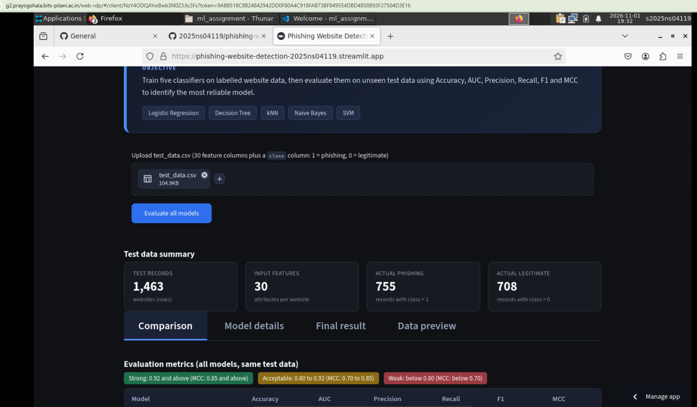
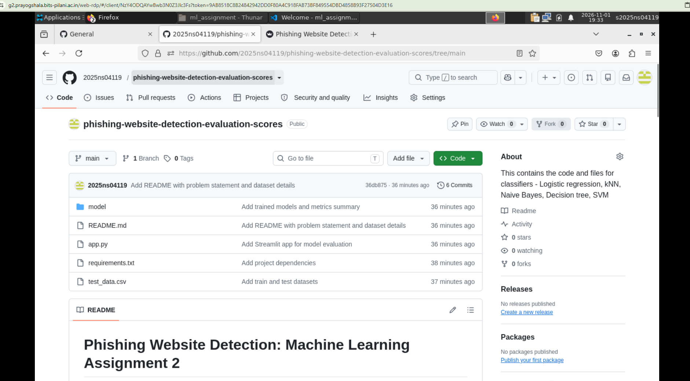

# Phishing Website Detection: Machine Learning Assignment 2

## a. Problem statement
Classify whether a website URL is a legitimate page or a phishing attempt designed to steal user
credentials. Blacklists cannot keep up with newly created phishing URLs, so five classification models
are trained on 81 URL, page-content and domain attributes and compared on unseen test data using
Accuracy, AUC, Precision, Recall, F1 and MCC. This is a binary classification problem
(`status` = 1 phishing, 0 legitimate).

## b. Dataset description
- **Source:** "Web page phishing detection" dataset on Kaggle:
  https://www.kaggle.com/datasets/shashwatwork/web-page-phishing-detection-dataset
  (created by Hannousse and Yahiouche, 2021, for benchmarking machine-learning phishing detectors).
- **Raw size:** 11,430 websites, 87 numeric features, 1 target (`status`), plus the `url` text column.
  The raw classes are perfectly balanced (5,715 phishing and 5,715 legitimate).
- **Feature groups:** URL-based features (lengths, character counts, ratios, suspicious words, brand
  and TLD checks), page-content features (hyperlinks, forms, iframes, pop-ups, favicon, title) and
  external-service features (domain age, registration length, web traffic, Google index, PageRank).
  The meaning of every column is listed at the end of this file.
- **Preparation:**
  - the `url` text column was dropped (models use the numeric features only);
  - 6 columns that hold a single constant value were dropped (`nb_or`, `ratio_nullHyperlinks`,
    `ratio_intRedirection`, `ratio_intErrors`, `submit_email`, `sfh`), leaving **81 features**;
  - `status` was recoded as 1 = phishing, 0 = legitimate;
  - 174 duplicate rows were removed, leaving 11,256 unique rows.
- **Split:** stratified 75/25, random seed 2025 -> 8,442 training rows (`model/train_data.csv`) and
  2,814 test rows (`test_data.csv`; 1,385 phishing and 1,429 legitimate). No row appears in both files.

## c. GitHub repository link
https://github.com/2025ns04119/phishing-website-detection-evaluation-scores

**Live Streamlit app:** https://phishing-website-detection-2025ns04119.streamlit.app

## d. Models used and evaluation metrics
Models: Logistic Regression, Decision Tree, kNN, Naive Bayes (Gaussian) and Support Vector Machine
(RBF kernel). Logistic Regression, kNN and SVM use a StandardScaler inside a scikit-learn pipeline.
All models were trained on `model/train_data.csv` and evaluated on `test_data.csv` (2,814 rows).

| ML Model Name | Accuracy | AUC | Precision | Recall | F1 | MCC |
|---|---|---|---|---|---|---|
| Logistic Regression | 0.9407 | 0.9837 | 0.9419 | 0.9372 | 0.9396 | 0.8813 |
| Decision Tree | 0.9357 | 0.9236 | 0.9356 | 0.9336 | 0.9346 | 0.8713 |
| kNN | 0.9350 | 0.9769 | 0.9465 | 0.9199 | 0.9330 | 0.8702 |
| Naive Bayes | 0.7409 | 0.8043 | 0.6841 | 0.8801 | 0.7698 | 0.5043 |
| Support Vector Machine (SVM) | 0.9566 | 0.9877 | 0.9606 | 0.9509 | 0.9557 | 0.9133 |

### Observations on model performance
| ML Model Name | Observation about model performance |
|---|---|
| Logistic Regression | Strong baseline and the second best model (MCC 0.8813). Precision and recall are close, and the high AUC (0.9837) shows it ranks phishing sites well even with a linear boundary. |
| Decision Tree | Good and balanced (MCC 0.8713), but its AUC (0.9236) is the lowest of the top four because a tree gives coarse probabilities. It makes 181 errors (89 false positives, 92 false negatives). |
| kNN | Similar to the Decision Tree (MCC 0.8702). It has the lowest recall of the top four (0.9199), missing 111 phishing sites, and prediction is slower because every training row is compared. |
| Naive Bayes | Weakest model (accuracy 0.7409, MCC 0.5043). It wrongly flags 563 legitimate sites. Many features are strongly related (lengths, counts and ratios of the same URL), which breaks the independence assumption of Naive Bayes. |
| Support Vector Machine (SVM) | Best on all six metrics. The RBF kernel captures non-linear interactions between the 81 features. Only 122 errors in 2,814 records (54 false positives and 68 false negatives). |

**Overall winner for this dataset: Support Vector Machine (SVM)** with MCC 0.9133, clearly ahead of
Logistic Regression (0.8813). Models are ranked by MCC, with F1 as the tie-breaker, because MCC uses
all four confusion-matrix counts.

## e. Execution on BITS Virtual Lab
All training, testing and the Streamlit app run were executed on the BITS Virtual Lab (VS Code, conda
environment). Screenshots of the execution:






## f. Streamlit app features and how to use it
**Steps to use the app**
1. Open the app link: https://phishing-website-detection-2025ns04119.streamlit.app
2. Click **Upload** under the title card and select `test_data.csv` from this repository.
3. Click **Evaluate all models**. All five models are scored on the uploaded file.
4. Explore the results in the four tabs below the test data summary.

**What each part of the app shows**
- **Test data summary:** number of test records, input features, and actual phishing and legitimate counts.
- **Comparison tab:** table and bar chart of Accuracy, AUC, Precision, Recall, F1 and MCC for all five models, with a short interpretation of each model.
- **Model details tab:** choose a model from the dropdown to see its metrics, confusion matrix and classification report.
- **Final result tab:** the recommended model and how it was chosen (ranked by MCC, with F1 as tie-breaker).
- **Data preview tab:** the first 15 rows of the uploaded file.

The uploaded file must have the same 81 feature columns as `test_data.csv` plus the `status` column (1 = phishing, 0 = legitimate).

## g. Project structure
```
app.py                    Streamlit app (upload test CSV, evaluate all models)
requirements.txt          Python dependencies
README.md                 This file
test_data.csv             Test data (upload this in the app)
virtual_lab/              Screenshots of the run on BITS Virtual Lab
model/                    train_pipeline.py, train_data.csv, saved models (*.pkl), metrics_summary.csv
```

## h. How to run in vscode
```bash
pip install -r requirements.txt
python model/train_pipeline.py     # trains and saves the 5 models
streamlit run app.py
```
Upload `test_data.csv` in the app and click **Evaluate all models**.

## i. Dataset description - continuation from b. (description about features in the dataset)
`status` is the target (1 = phishing, 0 = legitimate). The other columns are the input features.
Columns marked *(removed)* hold one constant value in the dataset and were dropped before training.

### URL-based features
| Column | Meaning |
|---|---|
| length_url | Number of characters in the whole URL |
| length_hostname | Number of characters in the host name |
| ip | URL uses an IP address instead of a domain name (1 = yes) |
| nb_dots | Number of `.` characters |
| nb_hyphens | Number of `-` characters |
| nb_at | Number of `@` characters |
| nb_qm | Number of `?` characters |
| nb_and | Number of `&` characters |
| nb_or | Number of `\|` characters *(removed)* |
| nb_eq | Number of `=` characters |
| nb_underscore | Number of `_` characters |
| nb_tilde | Number of `~` characters |
| nb_percent | Number of `%` characters |
| nb_slash | Number of `/` characters |
| nb_star | Number of `*` characters |
| nb_colon | Number of `:` characters |
| nb_comma | Number of `,` characters |
| nb_semicolumn | Number of `;` characters |
| nb_dollar | Number of `$` characters |
| nb_space | Number of spaces |
| nb_www | Number of times "www" appears |
| nb_com | Number of times "com" appears |
| nb_dslash | Number of `//` occurrences |
| http_in_path | "http" appears in the URL path |
| https_token | "https" appears as a token elsewhere in the URL (can mislead users) |
| ratio_digits_url | Share of digits in the URL |
| ratio_digits_host | Share of digits in the host name |
| punycode | URL uses punycode (encoded look-alike characters) |
| port | URL uses a non-standard port |
| tld_in_path | Top-level domain appears in the path |
| tld_in_subdomain | Top-level domain appears in the subdomain |
| abnormal_subdomain | Subdomain has an abnormal pattern (for example repeated "w") |
| nb_subdomains | Number of subdomains |
| prefix_suffix | Domain contains a `-` between a prefix and suffix |
| random_domain | Domain name looks randomly generated |
| shortening_service | URL uses a URL-shortening service |
| path_extension | Path ends with a file extension such as .txt or .exe |
| nb_redirection | Number of redirections in the URL |
| nb_external_redirection | Number of redirections to an external domain |
| length_words_raw | Number of words in the raw URL |
| char_repeat | Length of the longest repeated character sequence |
| shortest_words_raw | Length of the shortest word in the URL |
| shortest_word_host | Length of the shortest word in the host name |
| shortest_word_path | Length of the shortest word in the path |
| longest_words_raw | Length of the longest word in the URL |
| longest_word_host | Length of the longest word in the host name |
| longest_word_path | Length of the longest word in the path |
| avg_words_raw | Average word length in the URL |
| avg_word_host | Average word length in the host name |
| avg_word_path | Average word length in the path |
| phish_hints | Number of sensitive words often used in phishing (login, secure, account and similar) |
| domain_in_brand | Domain name is a known brand name |
| brand_in_subdomain | A brand name appears in the subdomain |
| brand_in_path | A brand name appears in the path |
| suspecious_tld | Top-level domain is commonly used by phishing sites |
| statistical_report | Host or IP appears in phishing statistics reports |

### Page-content features
| Column | Meaning |
|---|---|
| nb_hyperlinks | Number of hyperlinks on the page |
| ratio_intHyperlinks | Share of hyperlinks pointing to the same domain |
| ratio_extHyperlinks | Share of hyperlinks pointing to other domains |
| ratio_nullHyperlinks | Share of empty or null hyperlinks *(removed)* |
| nb_extCSS | Number of external CSS files |
| ratio_intRedirection | Share of internal links that redirect *(removed)* |
| ratio_extRedirection | Share of external links that redirect |
| ratio_intErrors | Share of internal links that give errors *(removed)* |
| ratio_extErrors | Share of external links that give errors |
| login_form | Page has a login form that posts to a suspicious address |
| external_favicon | Favicon is loaded from an external domain |
| links_in_tags | Share of links in meta, script and link tags pointing to other domains |
| submit_email | Page submits user data to an email address *(removed)* |
| ratio_intMedia | Share of images and media loaded from the same domain |
| ratio_extMedia | Share of images and media loaded from other domains |
| sfh | Server form handler is empty or external *(removed)* |
| iframe | Page uses an invisible iframe |
| popup_window | Page opens pop-up windows that ask for text input |
| safe_anchor | Share of anchor links that are unsafe (empty or pointing elsewhere) |
| onmouseover | Script changes the status bar on mouse over to hide the real link |
| right_clic | Right-click is disabled by script |
| empty_title | Page title is empty |
| domain_in_title | Domain name appears in the page title |
| domain_with_copyright | Domain name appears next to a copyright symbol |

### External-service features
| Column | Meaning |
|---|---|
| whois_registered_domain | Domain is registered in the WHOIS database |
| domain_registration_length | Remaining registration period of the domain |
| domain_age | Age of the domain |
| web_traffic | Website popularity rank |
| dns_record | Domain has a DNS record |
| google_index | Page is indexed by Google |
| page_rank | PageRank score of the page |
